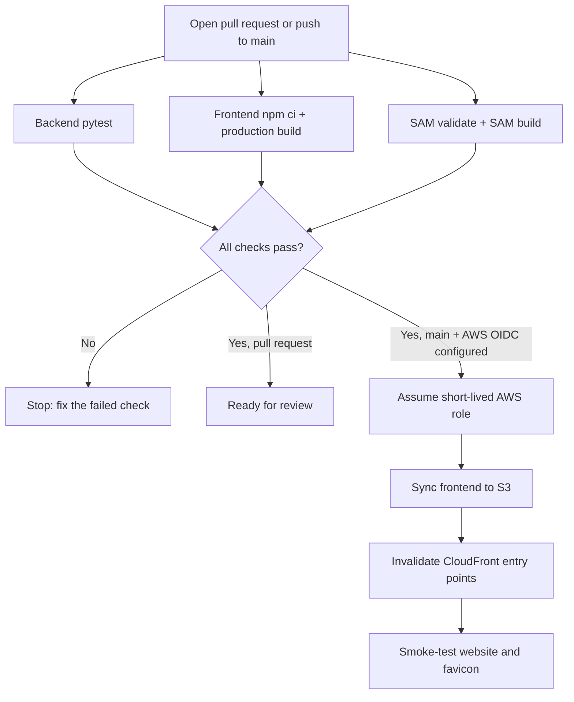

# Saans CI/CD — step-by-step learning guide

This guide explains the GitHub Actions pipeline in `.github/workflows/ci-cd.yml`.

## 1. The goal

After this pipeline is merged and configured:

1. Every pull request to `main` runs tests and builds.
2. A pull request cannot be used to deploy to AWS.
3. After code is merged to `main`, GitHub Actions tests the code again.
4. If every check passes and the AWS OIDC variables are configured, the frontend is automatically built, uploaded to the existing S3 bucket, and refreshed through CloudFront.
5. A workflow can also be started manually from the Actions tab.

The current pipeline deploys **the frontend only**. It does not deploy Lambda code or run `sam deploy`. Backend-Lambda continuous deployment should be a separate next lesson after this pipeline works.

## 2. The pipeline, in one picture



## 3. What CI means here

- **Continuous Integration (CI):** every proposed change is checked automatically before merge.
- **Backend tests:** installs Python dependencies, then runs `pytest`.
- **Frontend build:** installs exact versions from `package-lock.json`, runs TypeScript checks and Vite production build, and saves the exact `dist/` folder as a workflow artifact.
- **SAM validation/build:** validates `template.yaml` and packages the Lambda functions. It does not contact AWS or deploy the stack.
- **Artifact:** the built frontend files, passed from the build job to the deployment job. Deployment uses the same files that passed CI rather than rebuilding differently.

## 4. Configure GitHub repository variables

After reviewing/merging the workflow PR, open:

**GitHub repository → Settings → Secrets and variables → Actions → Variables → New repository variable**

Create these variables:

| Variable | Value |
|---|---|
| `AWS_DEPLOY_ROLE_ARN` | ARN of the narrowly scoped GitHub Actions IAM role created in step 5 |
| `AWS_FRONTEND_BUCKET` | `saans-demo-frontendbucket-ia0sc4ss1xgd` |
| `CLOUDFRONT_DISTRIBUTION_ID` | `E2SI62MPXJ62ED` |
| `VITE_API_BASE` | `https://m23og9ihef.execute-api.ap-south-1.amazonaws.com` |
| `AWS_FRONTEND_DOMAIN` | `d1rvgy019uvbns.cloudfront.net` |

These are configuration values, not AWS access keys. `VITE_API_BASE` and `AWS_FRONTEND_DOMAIN` are optional because safe defaults are included in the workflow. Do not create AWS access-key secrets for this pipeline.

Until the role ARN, bucket, and distribution variables exist, the deployment job is **skipped by design** while CI still runs.

## 5. Configure AWS authentication securely with OIDC

Do this once in AWS. Do not use the root user's access keys in GitHub.

### 5.1 Create or reuse the GitHub OIDC identity provider

In AWS IAM, open **Identity providers**. If the provider already exists, reuse it. Otherwise add an OpenID Connect provider:

- Provider URL: `https://token.actions.githubusercontent.com`
- Audience: `sts.amazonaws.com`

### 5.2 Create a dedicated role

Create an IAM role with web-identity federation and this trust policy. The repository was created after GitHub's immutable OIDC subject-claim change, so this subject is scoped to this repository, repository ID, owner ID and the `main` branch. Do not broaden the condition to all branches or all repositories.

```json
{
  "Version": "2012-10-17",
  "Statement": [
    {
      "Effect": "Allow",
      "Principal": {
        "Federated": "arn:aws:iam::089781651236:oidc-provider/token.actions.githubusercontent.com"
      },
      "Action": "sts:AssumeRoleWithWebIdentity",
      "Condition": {
        "StringEquals": {
          "token.actions.githubusercontent.com:aud": "sts.amazonaws.com",
          "token.actions.githubusercontent.com:sub": "repo:yashyp12@82149889/saans@1409106431:ref:refs/heads/main"
        }
      }
    }
  ]
}
```

If AWS already has the GitHub OIDC provider, do not create a duplicate. The role's trust policy must match the subject claim format GitHub actually issues for this repository; if AWS rejects the subject, stop and inspect GitHub's current OIDC claim configuration rather than weakening the trust policy.

### 5.3 Attach only the frontend deployment permissions

Attach this inline policy to the new role. It can list the Saans bucket, read object metadata where needed by sync, upload files, and invalidate the existing distribution. It cannot delete bucket objects, modify Lambda functions, alter IAM, or deploy CloudFormation.

```json
{
  "Version": "2012-10-17",
  "Statement": [
    {
      "Sid": "ListSaansFrontendBucket",
      "Effect": "Allow",
      "Action": ["s3:ListBucket"],
      "Resource": "arn:aws:s3:::saans-demo-frontendbucket-ia0sc4ss1xgd"
    },
    {
      "Sid": "ReadAndUploadSaansFrontendObjects",
      "Effect": "Allow",
      "Action": ["s3:GetObject", "s3:PutObject"],
      "Resource": "arn:aws:s3:::saans-demo-frontendbucket-ia0sc4ss1xgd/*"
    },
    {
      "Sid": "RefreshSaansCloudFront",
      "Effect": "Allow",
      "Action": [
        "cloudfront:CreateInvalidation",
        "cloudfront:GetInvalidation"
      ],
      "Resource": "arn:aws:cloudfront::089781651236:distribution/E2SI62MPXJ62ED"
    }
  ]
}
```

The workflow uses `aws-actions/configure-aws-credentials` with GitHub OIDC and verifies account `089781651236`. OIDC issues short-lived credentials; it avoids storing permanent AWS access keys in GitHub.

## 6. How you use it day to day

1. Create a feature branch.
2. Make changes and push the branch.
3. Open a pull request to `main`.
4. Open the PR's **Checks** tab. Fix any failing test or build before merging.
5. Merge after review. The push to `main` runs the checks and, once OIDC is configured, deploys the frontend.
6. Open the workflow run to review the S3 sync, CloudFront invalidation ID, and smoke-test results.

If you only want to test the pipeline, use **Actions → Saans CI/CD → Run workflow** on `main`. A manual run follows the same checks and deploys only when the AWS variables are configured.

## 7. Safety and rollback

- The workflow never runs `sam deploy`.
- The S3 sync intentionally has no `--delete` flag.
- Only pushes to `main` or manual runs on `main` can deploy.
- The AWS role is restricted to the one frontend bucket and one CloudFront distribution.
- If a frontend release is bad, revert the offending Git commit and merge the revert. The pipeline will redeploy the reverted frontend.

## 8. Interview explanation

> “I built a GitHub Actions CI/CD pipeline for Saans. Pull requests run Python unit tests, a TypeScript/Vite production build, and AWS SAM validation/build. After a reviewed change reaches main and all checks pass, the deployment job authenticates to AWS using OIDC and a least-privilege IAM role, syncs the frontend to a private S3 bucket, invalidates CloudFront, and smoke-tests the public site. I avoid permanent AWS keys, keep the frontend deployment separate from Lambda releases, and make every run auditable in GitHub Actions.”

## 9. Official references

- [GitHub: OpenID Connect in AWS](https://docs.github.com/en/actions/how-tos/secure-your-work/security-harden-deployments/oidc-in-aws)
- [AWS credentials action: OIDC setup](https://github.com/aws-actions/configure-aws-credentials)
- [GitHub: deployments and environments](https://docs.github.com/en/actions/how-tos/deploy/configure-and-manage-deployments/control-deployments)
- [AWS SAM setup action](https://github.com/aws-actions/setup-sam)
